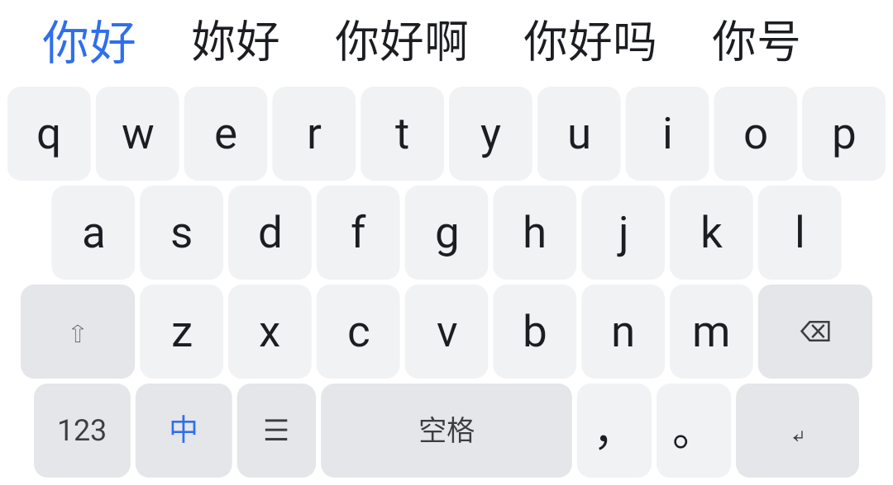
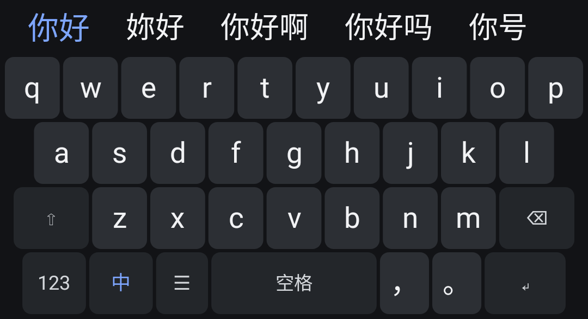
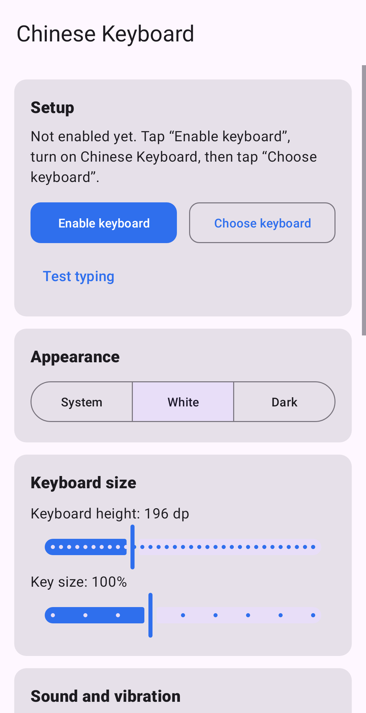

# Chinese Compact Keyboard

A complete, offline, compact Chinese keyboard for Android, written in Kotlin as a
native `InputMethodService`. It replaces the original starter project: the tiny
hardcoded word list is gone, replaced by a 190 000-entry pinyin dictionary with a
real segmentation and ranking engine, working Simplified/Traditional conversion,
a Room-backed clipboard history and a fully wired settings screen.

No internet permission is requested. Nothing leaves the device.

<table>
  <tr>
    <td></td>
    <td></td>
    <td></td>
  </tr>
  <tr>
    <td align="center">White theme, candidates for <code>nihao</code></td>
    <td align="center">Dark theme, same input</td>
    <td align="center">Settings</td>
  </tr>
</table>

The screenshots are produced by `ScreenshotTest`, which draws the real
`KeyboardView`, candidate bar and settings activity to a bitmap — regenerate with
`./gradlew testDebugUnitTest --tests '*ScreenshotTest*'`.

---

## 1. Quick start

1. Install `ChineseKeyboard-release.apk` (or `-debug.apk`) on an Android 10+
   device.
2. Open **Chinese Keyboard**.
3. Tap **Enable keyboard** → turn on *Chinese Keyboard* in the system list.
4. Tap **Choose keyboard** → pick *Chinese Keyboard*.
5. Tap **Test typing** and type `nihao`, `zhongguo`, `woaini`.

Inside any app: the ☰ key opens clipboard history, a long-press on ☰ opens the
settings, and the 中/EN key switches between Chinese and English.

---

## 2. What works

| Area | Behaviour |
|---|---|
| Pinyin input | Tone-independent, offline, 190 k words + 29 k characters, syllable segmentation with alternative readings (`xian` → 先 / 西安), prefix typing (`nih` → 你好), word-level sentence composition (`jintiantianqihenhao` → 今天天气很好) |
| Candidates | Weighted by corpus frequency, then re-ranked by the user's own word and word-pair statistics; the strip scrolls, first candidate is accented |
| Simplified / Traditional | Real conversion from the OpenCC phrase + character tables (53 k entries, Taiwan-standard glyphs). The 中 key mode decides what is inserted, not just the label |
| Compact UI | Single canvas-drawn view, 35 keys, 2 dp gaps, 32 dp candidate strip, 150–300 dp total height (default 196 dp, capped at 45 % of the screen), gesture-bar aware so the last row is never clipped, press animation, key preview, no relayout while typing |
| Clipboard | Room database, newest first, 100 entries max, tap to paste, copy button, per-entry delete, clear all, Chinese text preserved |
| Themes | White (light grey keys, dark text) and Dark (dark surface, grey keys, white text) plus *follow system*, switchable live from settings |
| Settings | Keyboard height, key size, key sound, vibration + strength, pinyin suggestions, candidate bar visibility, default Traditional, clipboard capture, clipboard manager, reset learning |
| Compatibility | `minSdk 29` (Android 10), `targetSdk 35`, native `InputMethodService`, `setComposingText`-based composition, correct `onStartInputView` / `onFinishInputView` lifecycle, editor actions on ↵ |

Keyboard layout (letters):

```
q w e r t y u i o p
 a s d f g h j k l
  ⇧  z x c v b n m  ⌫
123  中  ☰   space  ， 。  ↵
```

Long-press: ⌫ repeats delete, ☰ opens settings, space switches language.
123 opens a symbol page (digits, `@ # $ % & * - + ( )`, `/ " ' : ; ! ?`).

---

## 3. Architecture

```
app/src/main/java/com/example/chinesecompactkeyboard/
├── core/
│   ├── Prefs.kt              single source of truth for every setting
│   └── Theme.kt              light/dark palettes, system theme resolution
├── data/
│   ├── AppDatabase.kt        Room: clipboard_entries, user_words, user_bigrams
│   └── ClipboardRepository.kt clipboard capture, dedupe, trim, copy back
├── engine/
│   ├── AssetDictionary.kt    binary dictionary reader, prefix/exact search
│   ├── PinyinSegmenter.kt    syllable segmentation incl. partial last syllable
│   ├── PinyinEngine.kt       candidates, ranking, sentence composition
│   ├── TraditionalConverter.kt OpenCC longest-match converter
│   └── UserModel.kt          learned words + bigrams (Room backed, memory cached)
├── input/
│   ├── ChineseKeyboardService.kt  the IME
│   ├── KeyboardView.kt       canvas keyboard, animations, key preview
│   ├── KeyLayouts.kt         letters / symbols layouts
│   ├── CandidateBar.kt       candidate strip
│   └── ClipboardPanelView.kt clipboard panel inside the keyboard
└── ui/
    ├── MainActivity.kt       settings
    ├── ClipboardActivity.kt  clipboard manager
    └── TestActivity.kt       sandbox text field
```

Typing flow: key → `ChineseKeyboardService.onKey` → composition buffer →
`PinyinEngine.candidates` → candidate bar → `commitText`. The raw pinyin is
shown in the field through `setComposingText`, so a candidate replaces it
atomically and the field never shows half-converted text.

### Why the dictionary is fast and small

`pinyin_dict.0/.1/.2` (5.3 MB total, split only because very large single files
are awkward for repository tooling — the app concatenates them at load time)
store, in one byte array:

* a sorted ASCII key blob (`"ni hao"`), one entry per word,
* a UTF-8 word blob,
* an `IntArray` of weights, plus offset tables.

Keys are ASCII, so file order equals `String` order and lookups are a plain
binary search over raw bytes — no `String` allocation until a word actually
enters the candidate list. Measured on the JVM: **0.9 ms** per uncached lookup,
**0.02 ms** cached, **~70 ms** to load the whole dictionary (background thread at
service start).

---

## 4. Dictionary data and how to rebuild it

Sources (data only, no code):

* [rime/rime-luna-pinyin](https://github.com/rime/rime-luna-pinyin) — curated word readings
* [rime/rime-essay](https://github.com/rime/rime-essay) — word frequencies
* [mozillazg/phrase-pinyin-data](https://github.com/mozillazg/phrase-pinyin-data) — MIT, phrase readings
* [BYVoid/OpenCC](https://github.com/BYVoid/OpenCC) — simplified/traditional tables

`tools/build_dict.py` compiles them into `app/src/main/assets/pinyin_dict.bin` and
`trad_map.bin`. To regenerate:

```bash
mkdir dict-sources && cd dict-sources
git clone --depth 1 https://github.com/rime/rime-luna-pinyin luna
git clone --depth 1 https://github.com/rime/rime-essay essay
git clone --depth 1 https://github.com/mozillazg/phrase-pinyin-data
git clone --depth 1 https://github.com/BYVoid/OpenCC opencc
cd .. && python3 tools/build_dict.py
```

Everything is normalised to Simplified at build time; Traditional is produced at
runtime by the converter, so both modes share one dictionary.

---

## 5. Tests

```bash
./gradlew testDebugUnitTest
```

33 tests, all green:

* `PinyinEngineTest` — 19 assertions against the shipped dictionary: nihao→你好,
  zhongguo→中国, woaini→我爱你, xiexie→谢谢, zaijian→再见, xuexi→学习,
  uppercase/tone-independent input, partial syllables, sentence composition,
  alternative segmentations, Traditional conversion, converter phrase handling.
* `EnginePerformanceTest` — dictionary load, cached and uncached lookup latency.
* `KeyboardUiTest` (Robolectric) — 35 keys in the letters layout, touch → key
  dispatch, full-surface hit coverage, Chinese punctuation labels, symbol page.
* `AppSmokeTest` (Robolectric) — every activity inflates and the IME service
  builds its input view.
* `EngineDumpTest` — dumps ranked candidates for 48 common inputs to
  `engine_dump.txt` for eyeballing ranking changes.
* `ScreenshotTest` — renders the keyboard and settings screens to
  `docs/screenshots/*.png`. It uses Robolectric's native graphics mode, which
  needs its own JVM, so it is excluded from the default run:

  ```bash
  ./gradlew testDebugUnitTest -PwithScreenshots --tests '*ScreenshotTest*'
  ```

---

## 6. Building

Requirements: JDK 17, Android SDK 35 (`compileSdk`/`targetSdk` 35), Gradle 8.11.1
(the wrapper is included).

```bash
# Debug
./gradlew assembleDebug
# → app/build/outputs/apk/debug/app-debug.apk

# Release (signed)
./gradlew assembleRelease
# → app/build/outputs/apk/release/app-release.apk
```

Release signing reads `keystore.properties` + `keystore/release.jks` (a sample
pair is included in the downloadable project archive; it is deliberately kept out
of the git repository). Create your own before publishing:

```bash
keytool -genkeypair -v -keystore keystore/release.jks -alias chinesekeyboard \
  -keyalg RSA -keysize 2048 -validity 10000
```

Without `keystore.properties` the release build falls back to the debug key.

`minifyEnabled` is `false` in the shipped build because the APK was produced in a
2 GB-memory environment where R8 could not finish. On a normal workstation flip
it on:

```kotlin
release {
    isMinifyEnabled = true
    isShrinkResources = true
}
```

`app/proguard-rules.pro` already keeps the engine classes.

---

## 7. Permissions and privacy

Only `android.permission.VIBRATE` (normal permission, no prompt). No internet, no
storage, no contacts. Everything — dictionary, clipboard history, learned words —
lives in the app's private storage and can be cleared from Settings.

### Clipboard limitation (Android 10+)

Android only lets the *focused* app read the clipboard. An IME counts as focused
while its input view is visible, so:

* the current clip is read every time the keyboard opens, and again when you open
  the ☰ panel;
* copies made while the keyboard is closed appear the next time it opens;
* there is no background clipboard monitoring, by design — an app that did that
  would be violating the platform rules.

If a manufacturer blocks clipboard reads for IMEs, the panel says so instead of
failing silently.

---

## 8. Known limitations

* Dictionary coverage is ~190 k words; extremely rare or very new words fall back
  to character composition, which can produce homophone guesses.
* No emoji picker, no handwriting, no cloud sync, no user-defined phrases beyond
  automatic learning.
* Simplified/Traditional conversion is table-based (OpenCC), so a rare phrase may
  convert character-by-character.
* English mode is direct typing; there is no English autocorrect dictionary.
