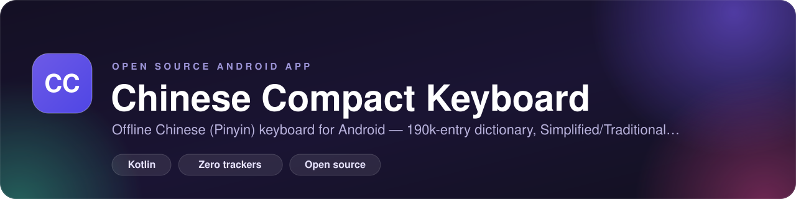

<div align="center">



<a href="https://github.com/technicalnihilist-lgtm/ChineseCompactKeyboard/stargazers"></a>&nbsp;<a href="https://github.com/technicalnihilist-lgtm/ChineseCompactKeyboard/network/members"></a>

<a href="https://github.com/technicalnihilist-lgtm/ChineseCompactKeyboard/releases/latest"></a>

<b>Support the work</b>

  

<sub>Donations aren't live yet — Paytm, UPI, PayPal and Buy&nbsp;Me&nbsp;a&nbsp;Coffee all show <b>coming soon</b>. Until then, a ⭐ star is the best support.</sub>

<a href="https://github.com/technicalnihilist-lgtm/ChineseCompactKeyboard/releases/latest"></a>  <a href="https://github.com/technicalnihilist-lgtm/ChineseCompactKeyboard/releases"></a>

</div>

---

## 2. What works

| Area | Behaviour |
|---|---|
| Pinyin input | Tone-independent, offline, 190 k words + 29 k characters, syllable segmentation with alternative readings (`xian` → 先 / 西安), prefix typing (`nih` → 你好), word-level sentence composition (`jintiantianqihenhao` → 今天天气很好) |
| Candidates | Weighted by corpus frequency, then re-ranked by the user's own word and word-pair statistics; the strip scrolls, first candidate is accented |
| Simplified / Traditional | Real conversion from the OpenCC phrase + character tables (53 k entries, Taiwan-standard glyphs). The 中 key mode decides what is inserted, not just the label |
| Compact UI | Single canvas-drawn view, 35 keys, 2 dp gaps, 32 dp candidate strip, 150–300 dp total height (default 196 dp, capped at 45 % of the screen), gesture-bar aware so the last row is never clipped, press animation, key preview, no relayout while typing |
| Clipboard | Room database, newest first, 100 entries max, tap to paste, copy button, per-entry delete, clear all, Chinese text preserved |
| Themes | White (light grey keys, dark text) and Dark (dark surface, grey keys, white text) plus *follow system*, switchable live from settings |
| Settings | Keyboard height, key size, key sound, vibration + strength, pinyin suggestions, candidate bar visibility, default Traditional, clipboard capture, clipboard manager, reset learning |
| Compatibility | `minSdk 29` (Android 10), `targetSdk 35`, native `InputMethodService`, `setComposingText`-based composition, correct `onStartInputView` / `onFinishInputView` lifecycle, editor actions on ↵ |

Keyboard layout (letters):

```
q w e r t y u i o p
 a s d f g h j k l
  ⇧  z x c v b n m  ⌫
123  中  ☰   space  ， 。  ↵
```

Long-press: ⌫ repeats delete, ☰ opens settings, space switches language.
123 opens a symbol page (digits, `@ # $ % & * - + ( )`, `/ " ' : ; ! ?`).

---

## 3. Architecture

```
app/src/main/java/com/example/chinesecompactkeyboard/
├── core/
│   ├── Prefs.kt              single source of truth for every setting
│   └── Theme.kt              light/dark palettes, system theme resolution
├── data/
│   ├── AppDatabase.kt        Room: clipboard_entries, user_words, user_bigrams
│   └── ClipboardRepository.kt clipboard capture, dedupe, trim, copy back
├── engine/
│   ├── AssetDictionary.kt    binary dictionary reader, prefix/exact search
│   ├── PinyinSegmenter.kt    syllable segmentation incl. partial last syllable
│   ├── PinyinEngine.kt       candidates, ranking, sentence composition
│   ├── TraditionalConverter.kt OpenCC longest-match converter
│   └── UserModel.kt          learned words + bigrams (Room backed, memory cached)
├── input/
│   ├── ChineseKeyboardService.kt  the IME
│   ├── KeyboardView.kt       canvas keyboard, animations, key preview
│   ├── KeyLayouts.kt         letters / symbols layouts
│   ├── CandidateBar.kt       candidate strip
│   └── ClipboardPanelView.kt clipboard panel inside the keyboard
└── ui/
    ├── MainActivity.kt       settings
    ├── ClipboardActivity.kt  clipboard manager
    └── TestActivity.kt       sandbox text field
```

Typing flow: key → `ChineseKeyboardService.onKey` → composition buffer →
`PinyinEngine.candidates` → candidate bar → `commitText`. The raw pinyin is
shown in the field through `setComposingText`, so a candidate replaces it
atomically and the field never shows half-converted text.

### Why the dictionary is fast and small

`pinyin_dict.0/.1/.2` (5.3 MB total, split only because very large single files
are awkward for repository tooling — the app concatenates them at load time)
store, in one byte array:

* a sorted ASCII key blob (`"ni hao"`), one entry per word,
* a UTF-8 word blob,
* an `IntArray` of weights, plus offset tables.

Keys are ASCII, so file order equals `String` order and lookups are a plain
binary search over raw bytes — no `String` allocation until a word actually
enters the candidate list. Measured on the JVM: **0.9 ms** per uncached lookup,
**0.02 ms** cached, **~70 ms** to load the whole dictionary (background thread at
service start).

---

## 4. Dictionary data and how to rebuild it

Sources (data only, no code):

* [rime/rime-luna-pinyin](https://github.com/rime/rime-luna-pinyin) — curated word readings
* [rime/rime-essay](https://github.com/rime/rime-essay) — word frequencies
* [mozillazg/phrase-pinyin-data](https://github.com/mozillazg/phrase-pinyin-data) — MIT, phrase readings
* [BYVoid/OpenCC](https://github.com/BYVoid/OpenCC) — simplified/traditional tables

`tools/build_dict.py` compiles them into `app/src/main/assets/pinyin_dict.bin` and
`trad_map.bin`. To regenerate:

```bash
mkdir dict-sources && cd dict-sources
git clone --depth 1 https://github.com/rime/rime-luna-pinyin luna
git clone --depth 1 https://github.com/rime/rime-essay essay
git clone --depth 1 https://github.com/mozillazg/phrase-pinyin-data
git clone --depth 1 https://github.com/BYVoid/OpenCC opencc
cd .. && python3 tools/build_dict.py
```

Everything is normalised to Simplified at build time; Traditional is produced at
runtime by the converter, so both modes share one dictionary.

---

## 5. Tests

```bash
./gradlew testDebugUnitTest
```

33 tests, all green:

* `PinyinEngineTest` — 19 assertions against the shipped dictionary: nihao→你好,
  zhongguo→中国, woaini→我爱你, xiexie→谢谢, zaijian→再见, xuexi→学习,
  uppercase/tone-independent input, partial syllables, sentence composition,
  alternative segmentations, Traditional conversion, converter phrase handling.
* `EnginePerformanceTest` — dictionary load, cached and uncached lookup latency.
* `KeyboardUiTest` (Robolectric) — 35 keys in the letters layout, touch → key
  dispatch, full-surface hit coverage, Chinese punctuation labels, symbol page.
* `AppSmokeTest` (Robolectric) — every activity inflates and the IME service
  builds its input view.
* `EngineDumpTest` — dumps ranked candidates for 48 common inputs to
  `engine_dump.txt` for eyeballing ranking changes.
* `ScreenshotTest` — renders the keyboard and settings screens to
  `docs/screenshots/*.png`. It uses Robolectric's native graphics mode, which
  needs its own JVM, so it is excluded from the default run:

  ```bash
  ./gradlew testDebugUnitTest -PwithScreenshots --tests '*ScreenshotTest*'
  ```

---

## 6. Building

Requirements: JDK 17, Android SDK 35 (`compileSdk`/`targetSdk` 35), Gradle 8.11.1
(the wrapper is included).

```bash
## 7. Permissions and privacy

Only `android.permission.VIBRATE` (normal permission, no prompt). No internet, no
storage, no contacts. Everything — dictionary, clipboard history, learned words —
lives in the app's private storage and can be cleared from Settings.

### Clipboard limitation (Android 10+)

Android only lets the *focused* app read the clipboard. An IME counts as focused
while its input view is visible, so:

* the current clip is read every time the keyboard opens, and again when you open
  the ☰ panel;
* copies made while the keyboard is closed appear the next time it opens;
* there is no background clipboard monitoring, by design — an app that did that
  would be violating the platform rules.

If a manufacturer blocks clipboard reads for IMEs, the panel says so instead of
failing silently.

---

## 8. Known limitations

* Dictionary coverage is ~190 k words; extremely rare or very new words fall back
  to character composition, which can produce homophone guesses.
* No emoji picker, no handwriting, no cloud sync, no user-defined phrases beyond
  automatic learning.
* Simplified/Traditional conversion is table-based (OpenCC), so a rare phrase may
  convert character-by-character.
* English mode is direct typing; there is no English autocorrect dictionary.

---

## 🌍 Languages

<sub>Donations are <b>coming soon</b> in every language below — nothing to pay today, nothing to click.</sub>

<div align="center">

<sub><b>हिन्दी · বাংলা · मराठी · తెలుగు · தமிழ் · ગુજરાતી · ಕನ್ನಡ · മലയാളം · ਪੰਜਾਬੀ · ଓଡ଼ିଆ · অসমীয়া · اردو</b></sub>

</div>

<details>
<summary><b>🌍 Open the same message in 53 languages</b></summary>

**🇮🇳 Indian languages**

- **हिन्दी** (Hindi) — ☕ जल्द ही आ रहा है। · ⭐ अगर आपको यह ऐप और हमारा काम पसंद है, तो कृपया रिपॉजिटरी को स्टार दें और हमें फॉलो करें।
- **বাংলা** (Bengali) — ☕ খুব শিগগিরই আসছে। · ⭐ যদি আপনার এই অ্যাপ এবং আমাদের কাজ ভালো লাগে, তবে অনুগ্রহ করে রিপোজিটরিটিকে একটি স্টার দিন এবং আমাদের ফলো করুন।
- **मराठी** (Marathi) — ☕ लवकरच येत आहे. · ⭐ जर तुम्हाला हे ॲप आणि आमचं काम आवडलं असेल, तर कृपया रिपॉझिटरीला स्टार द्या आणि आम्हाला फॉलो करा.
- **తెలుగు** (Telugu) — ☕ త్వరలో రాబోతోంది. · ⭐ మీకు ఈ యాప్, మా పని నచ్చితే, దయచేసి రిపోజిటరీకి ఒక స్టార్ ఇచ్చి మమ్మల్ని ఫాలో అవ్వండి.
- **தமிழ்** (Tamil) — ☕ விரைவில் வருகிறது. · ⭐ உங்களுக்கு இந்த ஆப்பும் எங்க வேலையும் பிடிச்சிருந்தா, தயவுசெஞ்சு இந்த ரெபாசிட்டரிக்கு ஒரு ஸ்டார்…
- **ગુજરાતી** (Gujarati) — ☕ ટૂંક સમયમાં આવી રહ્યું છે. · ⭐ જો તમને આ એપ અને અમારું કામ ગમતું હોય, તો પ્લીઝ રિપોઝિટરીને સ્ટાર આપો અને અમને ફોલો કરો.
- **ಕನ್ನಡ** (Kannada) — ☕ ಶೀಘ್ರದಲ್ಲೇ ಬರುತ್ತಿದೆ. · ⭐ ನಿಮಗೆ ಈ ಆ್ಯಪ್ ಮತ್ತು ನಮ್ಮ ಕೆಲಸ ಇಷ್ಟವಾದರೆ, ದಯವಿಟ್ಟು ರೆಪೊಸಿಟರಿಗೆ ಸ್ಟಾರ್ ಕೊಡಿ ಮತ್ತು ನಮ್ಮನ್ನು ಫಾಲೋ ಮಾಡಿ.
- **മലയാളം** (Malayalam) — ☕ ഉടൻ വരുന്നു. · ⭐ നിങ്ങൾക്ക് ഈ ആപ്പും ഞങ്ങളുടെ പ്രവർത്തനവും ഇഷ്ടപ്പെട്ടെങ്കിൽ, ദയവായി റെപ്പോസിറ്ററിക്ക് ഒരു സ്റ്റാർ…
- **ਪੰਜਾਬੀ** (Punjabi) — ☕ ਜਲਦੀ ਆ ਰਿਹਾ ਹੈ। · ⭐ ਜੇ ਤੁਹਾਨੂੰ ਇਹ ਐਪ ਅਤੇ ਸਾਡਾ ਕੰਮ ਪਸੰਦ ਹੈ, ਤਾਂ ਕਿਰਪਾ ਕਰਕੇ ਰਿਪੋਜ਼ਟਰੀ ਨੂੰ ਸਟਾਰ ਦਿਓ ਅਤੇ ਸਾਨੂੰ ਫਾਲੋ ਕਰੋ।
- **ଓଡ଼ିଆ** (Odia) — ☕ ଖୁବ୍ ଶୀଘ୍ର ଆସୁଛି। · ⭐ ଯଦି ଆପଣଙ୍କୁ ଏହି ଆପ୍ ଏବଂ ଆମର କାମ ଭଲ ଲାଗୁଛି, ତେବେ ଦୟାକରି ରିପୋଜିଟୋରୀକୁ ଗୋଟିଏ ଷ୍ଟାର୍ ଦିଅନ୍ତୁ ଏବଂ ଆମକୁ ଫଲୋ କରନ୍ତୁ।
- **অসমীয়া** (Assamese) — ☕ অতি সোনকালেই আহি আছে। · ⭐ যদি আপুনি এই এপটো আৰু আমাৰ কাম ভাল পায়, তেন্তে অনুগ্ৰহ কৰি ৰিপজিটৰীটোক এটা ষ্টাৰ দিয়ক আৰু আমাক ফ'ল' কৰক।
- **اردو** (Urdu) — ☕ جلد آرہا ہے۔ · ⭐ اگر آپ کو یہ ایپ اور ہمارا کام پسند آئے تو براہ کرم ریپازٹری کو سٹار دیں اور ہمیں فالو کریں۔
- **संस्कृतम्** (Sanskrit) — ☕ शीघ्रमेव आगच्छति।
- **मैथिली** (Maithili) — ☕ जल्दिये आबि रहल अछि।
- **कोंकणी** (Konkani) — ☕ रोखडेंच येता.
- **کٲشُر** (Kashmiri) — ☕ جَلدی یِوان چھُ۔
- **سنڌي** (Sindhi) — ☕ जल्द अची रह्यो आहे।
- **डोगरी** (Dogri) — ☕ जल्दी आ करदा ऐ।
- **ꯃꯤꯇꯩ ꯂꯣꯟ** (Manipuri) — ☕ ꯑꯊꯨꯕꯥ ꯃꯇꯝꯗꯥ ꯂꯥꯛꯀꯅꯤ꯫
- **बर’** (Bodo) — ☕ थाबैनो फैगोन।
- **ᱥᱟᱱᱛᱟᱲᱤ** (Santali) — ☕ ᱞᱚᱜᱚᱱ ᱦᱤᱡᱩᱜ ᱠᱟᱱᱟ᱾
- **नेपाली** (Nepali) — ☕ छिट्टै आउँदैछ। · ⭐ यदि तपाईंलाई यो एप र हाम्रो काम मन पर्‍यो भने, कृपया रिपोजिटरीलाई स्टार दिनुहोस् र हामीलाई फलो गर्नुहोस्।

**🌍 World languages**

- **العربية** (Arabic) — ☕ قريبًا. · ⭐ إذا أعجبك هذا التطبيق وعملنا، فيرجى منح المستودع نجمة ومتابعتنا.
- **简体中文** (Chinese (Simplified)) — ☕ 即将推出。
- **繁體中文** (Chinese (Traditional)) — ☕ 即將推出。
- **Čeština** (Czech) — ☕ Již brzy.
- **Dansk** (Danish) — ☕ Kommer snart.
- **Nederlands** (Dutch) — ☕ Binnenkort beschikbaar. · ⭐ Vind je deze app en ons werk leuk?
- **Filipino** (Filipino) — ☕ Malapit na.
- **Suomi** (Finnish) — ☕ Tulossa pian.
- **Français** (French) — ☕ Bientôt disponible. · ⭐ Si cette application et notre travail vous plaisent, mettez une étoile au dépôt et suivez-nous.
- **Deutsch** (German) — ☕ Bald verfügbar. · ⭐ Wenn dir diese App und unsere Arbeit gefallen, gib dem Repository einen Stern und folge uns.
- **Ελληνικά** (Greek) — ☕ Έρχεται σύντομα.
- **עברית** (Hebrew) — ☕ בקרוב.
- **Magyar** (Hungarian) — ☕ Hamarosan.
- **Bahasa Indonesia** (Indonesian) — ☕ Segera hadir. · ⭐ Jika kamu suka aplikasi ini dan karya kami, beri bintang pada repositori ini dan ikuti kami.
- **Italiano** (Italian) — ☕ In arrivo.
- **日本語** (Japanese) — ☕ 近日公開。 · ⭐ このアプリと私たちの仕事が気に入ったら、リポジトリにスターを付けてフォローしてください。
- **한국어** (Korean) — ☕ 곧 공개됩니다. · ⭐ 이 앱과 저희 작업이 마음에 드신다면 저장소에 스타를 눌러 주시고 팔로우해 주세요.
- **Bahasa Melayu** (Malay) — ☕ Akan datang.
- **Norsk** (Norwegian) — ☕ Kommer snart.
- **فارسی** (Persian) — ☕ به‌زودی.
- **Polski** (Polish) — ☕ Wkrótce. · ⭐ Jeśli podoba Ci się ta aplikacja i nasza praca, daj repozytorium gwiazdkę i obserwuj nas.
- **Português** (Portuguese) — ☕ Em breve.
- **Română** (Romanian) — ☕ În curând.
- **Русский** (Russian) — ☕ Скоро. · ⭐ Если вам нравится это приложение и наша работа, поставьте звёздочку репозиторию и подпишитесь на нас.
- **Español** (Spanish) — ☕ Muy pronto. · ⭐ Si te gusta esta app y nuestro trabajo, dale una estrella al repositorio y síguenos.
- **Kiswahili** (Swahili) — ☕ Inakuja hivi karibuni.
- **Svenska** (Swedish) — ☕ Kommer snart.
- **ไทย** (Thai) — ☕ เร็ว ๆ นี้
- **Türkçe** (Turkish) — ☕ Çok yakında.
- **Українська** (Ukrainian) — ☕ Незабаром.
- **Tiếng Việt** (Vietnamese) — ☕ Sắp ra mắt. · ⭐ Nếu bạn thích ứng dụng này và công việc của chúng tôi, hãy tặng kho lưu trữ một ngôi sao và theo…

</details>

