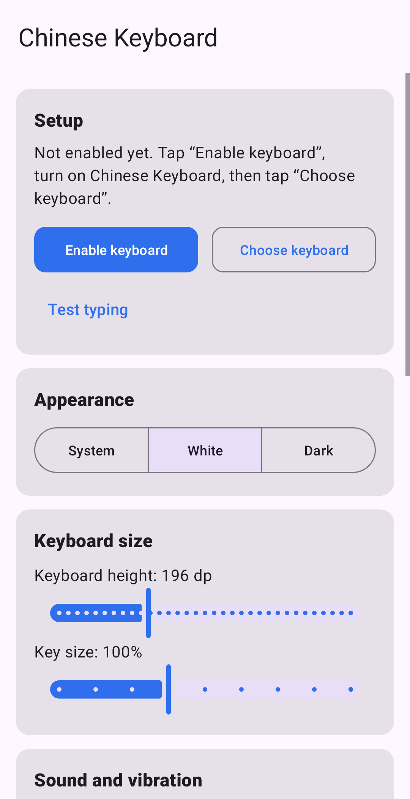

# Chinese Compact Keyboard

## ☕ Donate / Buy me a coffee

**Coming soon** — our donation options are on the way.

| Platform | Status |
| --- | --- |
| Paytm | Coming soon |
| PayPal | Coming soon |
| GPay (Google Pay) | Coming soon |

If you like our work, you can support us with a donation. We are bringing this very soon — **coming soon**.

---

## 🌐 Donate / Buy me a coffee — all languages

**Coming soon** · Paytm · PayPal · GPay — all coming soon.

<details>
<summary><b>🇮🇳 Indian languages</b></summary>

- **Hindi** (हिन्दी): ☕ Donate / Buy me a coffee — जल्द ही आ रहा है। Paytm, PayPal और GPay जल्द ही आ रहे हैं। अगर आपको हमारा काम पसंद है, तो आप डोनेशन देकर हमारा सपोर्ट कर सकते हैं। हम इसे बहुत जल्द ला रहे हैं।
- **Bengali** (বাংলা): ☕ Donate / Buy me a coffee — খুব শিগগিরই আসছে। Paytm, PayPal এবং GPay খুব শিগগিরই আসছে। আমাদের কাজ ভালো লাগলে, আপনি অনুদান দিয়ে আমাদের পাশে দাঁড়াতে পারেন। আমরা খুব তাড়াতাড়ি এটা নিয়ে আসছি।
- **Marathi** (मराठी): ☕ मला कॉफी दान करा / माझ्यासाठी कॉफी विकत घ्या — लवकरच येत आहे. Paytm, PayPal आणि GPay लवकरच येत आहेत. जर तुम्हाला आमचं काम आवडत असेल, तर तुम्ही आम्हाला देणगी देऊन सपोर्ट करू शकता. आम्ही हे लवकरच सुरू करत आहोत.
- **Telugu** (తెలుగు): ☕ నాకు కాఫీ కొనివ్వండి / విరాళం ఇవ్వండి — త్వరలో రాబోతోంది. Paytm, PayPal మరియు GPay త్వరలో రాబోతున్నాయి. మా పని మీకు నచ్చితే, మీరు విరాళం ఇవ్వడం ద్వారా మాకు మద్దతు ఇవ్వవచ్చు. దీన్ని మేము త్వరలోనే తీసుకువస్తున్నాము.
- **Tamil** (தமிழ்): ☕ எனக்கு ஒரு காபி வாங்கிக் கொடுங்கள் / நன்கொடை — விரைவில் வருகிறது. Paytm, PayPal மற்றும் GPay விரைவில் வரவுள்ளன. எங்களுடைய வேலை உங்களுக்குப் பிடித்திருந்தால், நன்கொடை அளித்து நீங்கள் எங்களுக்கு ஆதரவளிக்கலாம். இதை நாங்கள் விரைவில் கொண்டு வருகிறோம்.
- **Gujarati** (ગુજરાતી): ☕ મને કોફી દાન કરો / કોફી ખરીદો — ટૂંક સમયમાં આવી રહ્યું છે. Paytm, PayPal અને GPay ટૂંક સમયમાં આવી રહ્યા છે. જો તમને અમારું કામ ગમે, તો તમે અમને દાન આપીને સપોર્ટ કરી શકો છો. અમે તેને બહુ જલ્દી લાવી રહ્યા છીએ.
- **Kannada** (ಕನ್ನಡ): ☕ ಡೊನೇಟ್ / ನನಗೆ ಒಂದು ಕಾಫಿ ಕೊಡಿಸಿ — ಶೀಘ್ರದಲ್ಲೇ ಬರುತ್ತಿದೆ. Paytm, PayPal ಮತ್ತು GPay ಶೀಘ್ರದಲ್ಲೇ ಬರಲಿವೆ. ನಿಮಗೆ ನಮ್ಮ ಕೆಲಸ ಇಷ್ಟವಾದರೆ, ನೀವು ದೇಣಿಗೆ ನೀಡುವ ಮೂಲಕ ನಮಗೆ ಬೆಂಬಲ ನೀಡಬಹುದು. ನಾವು ಇದನ್ನು ಬಹಳ ಶೀಘ್ರದಲ್ಲೇ ತರುತ್ತಿದ್ದೇವೆ.
- **Malayalam** (മലയാളം): ☕ Donate / Buy me a coffee — ഉടൻ വരുന്നു. Paytm, PayPal, GPay എന്നിവ ഉടൻ വരുന്നു. ഞങ്ങളുടെ വർക്കുകൾ നിങ്ങൾക്ക് ഇഷ്ടമാണെങ്കിൽ, ഒരു സംഭാവന നൽകി ഞങ്ങളെ പിന്തുണയ്ക്കാം. ഞങ്ങൾ ഇത് വളരെ വേഗം കൊണ്ടുവരുന്നുണ്ട്.
- **Odia** (ଓଡ଼ିଆ): ☕ ମୋତେ କଫି କିଣି ଦିଅନ୍ତୁ / ଡୋନେଟ୍ କରନ୍ତୁ — ଖୁବ୍ ଶୀଘ୍ର ଆସୁଛି। Paytm, PayPal ଏବଂ GPay ଖୁବ୍ ଶୀଘ୍ର ଆସୁଛି। ଯଦି ଆପଣଙ୍କୁ ଆମ କାମ ପସନ୍ଦ, ତେବେ ଆପଣ ଆମକୁ ଡୋନେସନ୍ ଦେଇ ସପୋର୍ଟ କରିପାରିବେ। ଆମେ ଏହାକୁ ଖୁବ୍ ଶୀଘ୍ର ଆଣିବୁ।
- **Punjabi** (ਪੰਜਾਬੀ): ☕ ਮੈਨੂੰ ਕੌਫੀ ਦਾਨ ਕਰੋ / ਮੇਰੇ ਲਈ ਕੌਫੀ ਖਰੀਦੋ — ਜਲਦੀ ਆ ਰਿਹਾ ਹੈ। Paytm, PayPal ਅਤੇ GPay ਜਲਦੀ ਆ ਰਹੇ ਹਨ। ਜੇਕਰ ਤੁਹਾਨੂੰ ਸਾਡਾ ਕੰਮ ਪਸੰਦ ਹੈ, ਤਾਂ ਤੁਸੀਂ ਦਾਨ ਦੇ ਕੇ ਸਾਡਾ ਸਾਥ ਦੇ ਸਕਦੇ ਹੋ। ਅਸੀਂ ਇਸਨੂੰ ਬਹੁਤ ਜਲਦੀ ਲੈ ਕੇ ਆ ਰਹੇ ਹਾਂ।
- **Assamese** (অসমীয়া): ☕ Donate / Buy me a coffee — অতি সোনকালেই আহি আছে। Paytm, PayPal আৰু GPay অতি সোনকালেই আহি আছে। যদি আপুনি আমাৰ কাম ভাল পায়, তেন্তে আপুনি দান কৰি আমাক সহায় কৰিব পাৰে। আমি এইটো অতি সোনকালেই লৈ আহি আছোঁ।
- **Urdu** (اردو): ☕ مجھے کافی ڈونیٹ / خریدیں — جلد آرہا ہے۔ Paytm، PayPal اور GPay جلد آرہے ہیں۔ اگر آپ کو ہمارا کام پسند ہے، تو آپ ڈونیشن دے کر ہماری مدد کر سکتے ہیں۔ ہم اسے بہت جلد لا رہے ہیں۔
- **Nepali** (नेपाली): ☕ मलाई कफी किनिदिनुहोस् / दान गर्नुहोस् — छिट्टै आउँदैछ। Paytm, PayPal र GPay पनि छिट्टै आउँदैछन्। यदि तपाईंलाई हाम्रो काम मन पर्छ भने, तपाईंले हामीलाई दान गरेर सहयोग गर्न सक्नुहुन्छ। हामी यो सुविधा धेरै चाँडै ल्याउँदैछौं।
- **Sanskrit** (संस्कृतम्): ☕ मह्यं काफीं क्रीणन्तु / दानं कुर्वन्तु — शीघ्रमेव आगच्छति। Paytm, PayPal तथा GPay अपि शीघ्रमेव आगच्छन्ति। यदि भवन्तः अस्माकं कार्यं रोचन्ते, तर्हि दानं कृत्वा अस्मान् समर्थयितुं शक्नुवन्ति। वयं तत् शीघ्रमेव आनयामः।
- **Konkani** (कोंकणी): ☕ म्हाका कॉफी दान करात / म्हजे खातीर कॉफी घेयात — रोखडेंच येता. Paytm, PayPal आनी GPay रोखडेंच येतले. तुमकां आमचें काम आवडल्यार, तुमी आमकां देणगी दिवन आदार करूंक शकतात. आमी तें खूब बेगीन हाडटात.
- **Maithili** (मैथिली): ☕ हमरा लेल कॉफी डोनेट करू / खरीदू — जल्दिये आबि रहल अछि। Paytm, PayPal आ GPay जल्दिये आबि रहल अछि। जँ अहाँकेँ हमर काज नीक लागैत अछि, तँ अहाँ दान कऽ कऽ हमर समर्थन कऽ सकैत छी। हम एकरा बहुत जल्दी लाबि रहल छी।
- **Kashmiri** (کٲشُر): ☕ مےٚ دِیِو اَکھ کافی — جَلدی یِوان چھُ۔ Paytm, PayPal تہٕ GPay چھِ جَلدی یِوان۔ اَگر تُہؠ سٲنؠ کٲم پَسَند چھِو کَران، تُہؠ ہیٚکِو اَسے اَکھ ڈونیشَن دِتھ سَپورٹ کٔرِتھ۔ اَسؠ چھِ یہِ واریاہ جَلدی اَنان۔
- **Sindhi** (سنڌي): ☕ डोनेट / मूंखे हिक कॉफी वठायो — जल्द अची रह्यो आहे। Paytm, PayPal ऐं GPay जल्द अची रह्या आहिन। जेकडहिं तव्हां खे असां जो कमु वणंदो आहे, त तव्हां असां खे डोनेशन डई सपोर्ट करे सघो था। असीं इहो डाढो जल्द आणी रह्या आहियूं।
- **Dogri** (डोगरी): ☕ डोनेट / मेरे लेई इक कॉफी खरीदो — जल्दी आ करदा ऐ। Paytm, PayPal ते GPay जल्दी आ करदे न। जेकर तुसेंगी साढ़ा कम्म पसंद ऐ, तां तुस साढ़ी मदद दान देइयै करी सकदे ओ। अस इसगी बड़ा जल्दी लेई आ करदे आं।
- **Manipuri** (ꯃꯤꯇꯩ ꯂꯣꯟ): ☕ ꯗꯣꯅꯦꯠ / ꯑꯩꯉꯣꯟꯗꯥ ꯀꯣꯐꯤ ꯑꯃꯥ ꯂꯩꯕꯤꯔꯛꯎ — ꯑꯊꯨꯕꯥ ꯃꯇꯝꯗꯥ ꯂꯥꯛꯀꯅꯤ꯫ Paytm, PayPal ꯑꯃꯁꯨꯡ GPay ꯑꯊꯨꯕꯥ ꯃꯇꯝꯗꯥ ꯂꯥꯛꯀꯅꯤ꯫ ꯀꯔꯤꯒꯨꯝꯕꯥ ꯅꯈꯣꯌꯅꯥ ꯑꯩꯈꯣꯌꯒꯤ ꯊꯕꯛ ꯑꯁꯤ ꯄꯥꯝꯂꯕꯗꯤ, ꯅꯈꯣꯌꯅꯥ ꯗꯣꯅꯦꯁꯟ ꯑꯃꯒꯥ ꯂꯣꯌꯅꯅꯥ ꯑꯩꯈꯣꯌꯕꯨ ꯃꯇꯦꯡ ꯄꯥꯡꯕꯤꯕꯥ ꯌꯥꯏ꯫ ꯑꯩꯈꯣꯌꯅꯥ ꯃꯁꯤ ꯑꯊꯨꯕꯥ ꯃꯇꯝꯗꯥ ꯄꯨꯔꯛꯂꯤ꯫
- **Bodo** (बर’): ☕ आंनो कफि बायना हो — थाबैनो फैगोन। Paytm, PayPal आरो GPay आ थाबैनो फैगोन। जुदि नोंथांमोना जोंनि हाबाखौ मोजां मोनो, नोंथांमोना जोंखौ दान होनानै मदद खालामनो हागोन। जों बेखौ थाबैनो लाबोगोन।
- **Santali** (ᱥᱟᱱᱛᱟᱲᱤ): ☕ ᱫᱟᱱ / ᱤᱧ ᱢᱤᱫ ᱠᱚᱯᱷᱤ ᱠᱤᱨᱤᱧ ᱤᱧ — ᱞᱚᱜᱚᱱ ᱦᱤᱡᱩᱜ ᱠᱟᱱᱟ᱾ Paytm, PayPal ᱟᱨ GPay ᱞᱚᱜᱚᱱ ᱦᱤᱡᱩᱜ ᱠᱟᱱᱟ᱾ ᱡᱩᱫᱤ ᱟᱞᱮᱭᱟᱜ ᱠᱟᱹᱢᱤ ᱯᱮ ᱠᱩᱥᱤᱭᱟᱜ ᱠᱟᱱᱟ, ᱮᱱᱠᱷᱟᱱ ᱫᱟᱱ ᱠᱟᱛᱮ ᱟᱞᱮ ᱜᱚᱲᱚ ᱫᱟᱲᱮᱭᱟᱯᱮᱭᱟ ᱯᱮ᱾ ᱟᱞᱮ ᱱᱚᱶᱟ ᱟᱹᱰᱤ ᱞᱚᱜᱚᱱ ᱞᱮ ᱟᱹᱜᱩᱭᱮᱫᱟ᱾

</details>

<details>
<summary><b>🌍 Global languages</b></summary>

- **Spanish** (Español): ☕ Donar / Invítame un café — Muy pronto. Paytm, PayPal y GPay estarán disponibles muy pronto. Si te gusta nuestro trabajo, puedes apoyarnos con una donación. Lo estamos lanzando muy pronto.
- **French** (Français): ☕ Faire un don / Offrez-moi un café — Bientôt disponible. Paytm, PayPal et GPay arrivent très bientôt. Si vous aimez notre travail, vous pouvez nous soutenir avec un don. Nous le mettons en place très bientôt.
- **German** (Deutsch): ☕ Spenden / Spendier mir einen Kaffee — Bald verfügbar. Paytm, PayPal und GPay kommen sehr bald. Wenn dir unsere Arbeit gefällt, kannst du uns mit einer Spende unterstützen. Wir bringen es sehr bald.
- **Portuguese** (Português): ☕ Doar / Pague-me um café — Em breve. Paytm, PayPal e GPay chegam em breve. Se você gosta do nosso trabalho, pode nos apoiar com uma doação. Estamos trazendo isso muito em breve.
- **Italian** (Italiano): ☕ Dona / Offrimi un caffè — In arrivo. Paytm, PayPal e GPay arrivano presto. Se ti piace il nostro lavoro, puoi sostenerci con una donazione. Lo stiamo lanciando molto presto.
- **Dutch** (Nederlands): ☕ Doneer / Trakteer me op een koffie — Binnenkort beschikbaar. Paytm, PayPal en GPay komen binnenkort. Als je ons werk leuk vindt, kun je ons steunen met een donatie. We brengen dit heel binnenkort.
- **Polish** (Polski): ☕ Przekaż datek / Postaw mi kawę — Wkrótce. Paytm, PayPal i GPay już wkrótce. Jeśli podoba Ci się nasza praca, możesz nas wesprzeć datkiem. Wprowadzamy to bardzo szybko.
- **Russian** (Русский): ☕ Пожертвовать / Купи мне кофе — Скоро. Paytm, PayPal и GPay появятся совсем скоро. Если вам нравится наша работа, вы можете поддержать нас пожертвованием. Мы запускаем это очень скоро.
- **Ukrainian** (Українська): ☕ Пожертвувати / Купи мені каву — Незабаром. Paytm, PayPal і GPay з'являться дуже скоро. Якщо вам подобається наша робота, ви можете підтримати нас пожертвою. Ми запускаємо це дуже скоро.
- **Turkish** (Türkçe): ☕ Bağış yap / Bana bir kahve ısmarla — Çok yakında. Paytm, PayPal ve GPay çok yakında geliyor. İşimizi beğendiyseniz bağışla bizi destekleyebilirsiniz. Çok yakında sunuyoruz.
- **Arabic** (العربية): ☕ تبرّع / اشترِ لي قهوة — قريبًا. Paytm وPayPal وGPay ستتوفر قريبًا جدًا. إذا أعجبك عملنا، يمكنك دعمنا بالتبرع. نطرحه قريبًا جدًا.
- **Persian** (فارسی): ☕ کمک مالی / برایم یک قهوه بخر — به‌زودی. Paytm، PayPal و GPay به‌زودی اضافه می‌شوند. اگر کار ما را دوست دارید، می‌توانید با یک کمک مالی از ما حمایت کنید. این قابلیت را خیلی زود اضافه می‌کنیم.
- **Hebrew** (עברית): ☕ תרומה / קנו לי קפה — בקרוב. Paytm, PayPal ו-GPay יגיעו בקרוב מאוד. אם אתם אוהבים את העבודה שלנו, תוכלו לתמוך בנו בתרומה. אנחנו מביאים את זה בקרוב מאוד.
- **Indonesian** (Bahasa Indonesia): ☕ Donasi / Traktir saya kopi — Segera hadir. Paytm, PayPal, dan GPay segera hadir. Jika Anda menyukai karya kami, Anda dapat mendukung kami dengan donasi. Kami akan menghadirkannya segera.
- **Malay** (Bahasa Melayu): ☕ Derma / Belanja saya kopi — Akan datang. Paytm, PayPal dan GPay akan datang tidak lama lagi. Jika anda suka hasil kerja kami, anda boleh menyokong kami dengan derma. Kami akan membawanya tidak lama lagi.
- **Vietnamese** (Tiếng Việt): ☕ Quyên góp / Mời tôi một ly cà phê — Sắp ra mắt. Paytm, PayPal và GPay sẽ sớm ra mắt. Nếu bạn thích công việc của chúng tôi, bạn có thể ủng hộ bằng một khoản quyên góp. Chúng tôi sẽ sớm mang tính năng này đến.
- **Thai** (ไทย): ☕ บริจาค / เลี้ยงกาแฟฉันสักแก้ว — เร็ว ๆ นี้ Paytm, PayPal และ GPay กำลังจะมาเร็ว ๆ นี้ หากคุณชอบผลงานของเรา คุณสามารถสนับสนุนเราด้วยการบริจาค เรากำลังจะเปิดให้ใช้เร็ว ๆ นี้
- **Japanese** (日本語): ☕ 寄付 / コーヒーをおごる — 近日公開。Paytm、PayPal、GPay も近日対応予定です。私たちの仕事を気に入っていただけたら、寄付で支援できます。まもなく公開します。
- **Korean** (한국어): ☕ 후원 / 커피 한 잔 사주기 — 곧 공개됩니다. Paytm, PayPal, GPay도 곧 지원됩니다. 저희 작업이 마음에 드신다면 후원으로 지원하실 수 있습니다. 곧 선보이겠습니다.
- **Chinese (Simplified)** (简体中文): ☕ 捐赠 / 请我喝杯咖啡 — 即将推出。Paytm、PayPal 和 GPay 即将上线。如果你喜欢我们的作品，可以通过捐赠支持我们。我们很快就会推出。
- **Chinese (Traditional)** (繁體中文): ☕ 捐贈 / 請我喝杯咖啡 — 即將推出。Paytm、PayPal 和 GPay 即將上線。如果你喜歡我們的作品，可以透過捐贈支持我們。我們很快就會推出。
- **Greek** (Ελληνικά): ☕ Δωρεά / Κέρασέ με έναν καφέ — Έρχεται σύντομα. Paytm, PayPal και GPay έρχονται σύντομα. Αν σας αρέσει η δουλειά μας, μπορείτε να μας στηρίξετε με μια δωρεά. Το φέρνουμε πολύ σύντομα.
- **Czech** (Čeština): ☕ Darovat / Kup mi kávu — Již brzy. Paytm, PayPal a GPay budou brzy k dispozici. Pokud se vám naše práce líbí, můžete nás podpořit darem. Přinášíme to velmi brzy.
- **Romanian** (Română): ☕ Donează / Cumpără-mi o cafea — În curând. Paytm, PayPal și GPay vor fi disponibile în curând. Dacă îți place munca noastră, ne poți susține cu o donație. O aducem foarte curând.
- **Hungarian** (Magyar): ☕ Adományozás / Hívj meg egy kávéra — Hamarosan. A Paytm, a PayPal és a GPay hamarosan elérhető. Ha tetszik a munkánk, adománnyal támogathatsz minket. Nagyon hamarosan elhozzuk.
- **Swedish** (Svenska): ☕ Donera / Bjud mig på en kaffe — Kommer snart. Paytm, PayPal och GPay kommer snart. Om du gillar vårt arbete kan du stötta oss med en donation. Vi lanserar det mycket snart.
- **Danish** (Dansk): ☕ Donér / Køb en kaffe til mig — Kommer snart. Paytm, PayPal og GPay kommer snart. Hvis du kan lide vores arbejde, kan du støtte os med en donation. Vi kommer med det meget snart.
- **Norwegian** (Norsk): ☕ Doner / Kjøp en kaffe til meg — Kommer snart. Paytm, PayPal og GPay kommer snart. Hvis du liker arbeidet vårt, kan du støtte oss med en donasjon. Vi lanserer det svært snart.
- **Finnish** (Suomi): ☕ Lahjoita / Tarjoa minulle kahvi — Tulossa pian. Paytm, PayPal ja GPay tulevat pian. Jos pidät työstämme, voit tukea meitä lahjoituksella. Tuomme sen hyvin pian.
- **Swahili** (Kiswahili): ☕ Changia / Ninunulie kahawa — Inakuja hivi karibuni. Paytm, PayPal na GPay zinakuja hivi karibuni. Ikiwa unapenda kazi yetu, unaweza kutusaidia kwa mchango. Tunaileta hivi karibuni.
- **Filipino** (Filipino): ☕ Mag-donate / Bilhan mo ako ng kape — Malapit na. Paparating na ang Paytm, PayPal at GPay. Kung gusto mo ang aming gawa, matutulungan mo kami sa pamamagitan ng donasyon. Ilalabas namin ito sa lalong madaling panahon.

</details>

---

A complete, offline, compact Chinese keyboard for Android, written in Kotlin as a
native `InputMethodService`. It replaces the original starter project: the tiny
hardcoded word list is gone, replaced by a 190 000-entry pinyin dictionary with a
real segmentation and ranking engine, working Simplified/Traditional conversion,
a Room-backed clipboard history and a fully wired settings screen.

No internet permission is requested. Nothing leaves the device.

<table>
  <tr>
    <td></td>
    <td></td>
    <td></td>
  </tr>
  <tr>
    <td align="center">White theme, candidates for <code>nihao</code></td>
    <td align="center">Dark theme, same input</td>
    <td align="center">Settings</td>
  </tr>
</table>

The screenshots are produced by `ScreenshotTest`, which draws the real
`KeyboardView`, candidate bar and settings activity to a bitmap — regenerate with
`./gradlew testDebugUnitTest --tests '*ScreenshotTest*'`.

---

## 1. Quick start

1. Install `ChineseKeyboard-release.apk` (or `-debug.apk`) on an Android 10+
   device.
2. Open **Chinese Keyboard**.
3. Tap **Enable keyboard** → turn on *Chinese Keyboard* in the system list.
4. Tap **Choose keyboard** → pick *Chinese Keyboard*.
5. Tap **Test typing** and type `nihao`, `zhongguo`, `woaini`.

Inside any app: the ☰ key opens clipboard history, a long-press on ☰ opens the
settings, and the 中/EN key switches between Chinese and English.

---

## 2. What works

| Area | Behaviour |
|---|---|
| Pinyin input | Tone-independent, offline, 190 k words + 29 k characters, syllable segmentation with alternative readings (`xian` → 先 / 西安), prefix typing (`nih` → 你好), word-level sentence composition (`jintiantianqihenhao` → 今天天气很好) |
| Candidates | Weighted by corpus frequency, then re-ranked by the user's own word and word-pair statistics; the strip scrolls, first candidate is accented |
| Simplified / Traditional | Real conversion from the OpenCC phrase + character tables (53 k entries, Taiwan-standard glyphs). The 中 key mode decides what is inserted, not just the label |
| Compact UI | Single canvas-drawn view, 35 keys, 2 dp gaps, 32 dp candidate strip, 150–300 dp total height (default 196 dp, capped at 45 % of the screen), gesture-bar aware so the last row is never clipped, press animation, key preview, no relayout while typing |
| Clipboard | Room database, newest first, 100 entries max, tap to paste, copy button, per-entry delete, clear all, Chinese text preserved |
| Themes | White (light grey keys, dark text) and Dark (dark surface, grey keys, white text) plus *follow system*, switchable live from settings |
| Settings | Keyboard height, key size, key sound, vibration + strength, pinyin suggestions, candidate bar visibility, default Traditional, clipboard capture, clipboard manager, reset learning |
| Compatibility | `minSdk 29` (Android 10), `targetSdk 35`, native `InputMethodService`, `setComposingText`-based composition, correct `onStartInputView` / `onFinishInputView` lifecycle, editor actions on ↵ |

Keyboard layout (letters):

```
q w e r t y u i o p
 a s d f g h j k l
  ⇧  z x c v b n m  ⌫
123  中  ☰   space  ， 。  ↵
```

Long-press: ⌫ repeats delete, ☰ opens settings, space switches language.
123 opens a symbol page (digits, `@ # $ % & * - + ( )`, `/ " ' : ; ! ?`).

---

## 3. Architecture

```
app/src/main/java/com/example/chinesecompactkeyboard/
├── core/
│   ├── Prefs.kt              single source of truth for every setting
│   └── Theme.kt              light/dark palettes, system theme resolution
├── data/
│   ├── AppDatabase.kt        Room: clipboard_entries, user_words, user_bigrams
│   └── ClipboardRepository.kt clipboard capture, dedupe, trim, copy back
├── engine/
│   ├── AssetDictionary.kt    binary dictionary reader, prefix/exact search
│   ├── PinyinSegmenter.kt    syllable segmentation incl. partial last syllable
│   ├── PinyinEngine.kt       candidates, ranking, sentence composition
│   ├── TraditionalConverter.kt OpenCC longest-match converter
│   └── UserModel.kt          learned words + bigrams (Room backed, memory cached)
├── input/
│   ├── ChineseKeyboardService.kt  the IME
│   ├── KeyboardView.kt       canvas keyboard, animations, key preview
│   ├── KeyLayouts.kt         letters / symbols layouts
│   ├── CandidateBar.kt       candidate strip
│   └── ClipboardPanelView.kt clipboard panel inside the keyboard
└── ui/
    ├── MainActivity.kt       settings
    ├── ClipboardActivity.kt  clipboard manager
    └── TestActivity.kt       sandbox text field
```

Typing flow: key → `ChineseKeyboardService.onKey` → composition buffer →
`PinyinEngine.candidates` → candidate bar → `commitText`. The raw pinyin is
shown in the field through `setComposingText`, so a candidate replaces it
atomically and the field never shows half-converted text.

### Why the dictionary is fast and small

`pinyin_dict.0/.1/.2` (5.3 MB total, split only because very large single files
are awkward for repository tooling — the app concatenates them at load time)
store, in one byte array:

* a sorted ASCII key blob (`"ni hao"`), one entry per word,
* a UTF-8 word blob,
* an `IntArray` of weights, plus offset tables.

Keys are ASCII, so file order equals `String` order and lookups are a plain
binary search over raw bytes — no `String` allocation until a word actually
enters the candidate list. Measured on the JVM: **0.9 ms** per uncached lookup,
**0.02 ms** cached, **~70 ms** to load the whole dictionary (background thread at
service start).

---

## 4. Dictionary data and how to rebuild it

Sources (data only, no code):

* [rime/rime-luna-pinyin](https://github.com/rime/rime-luna-pinyin) — curated word readings
* [rime/rime-essay](https://github.com/rime/rime-essay) — word frequencies
* [mozillazg/phrase-pinyin-data](https://github.com/mozillazg/phrase-pinyin-data) — MIT, phrase readings
* [BYVoid/OpenCC](https://github.com/BYVoid/OpenCC) — simplified/traditional tables

`tools/build_dict.py` compiles them into `app/src/main/assets/pinyin_dict.bin` and
`trad_map.bin`. To regenerate:

```bash
mkdir dict-sources && cd dict-sources
git clone --depth 1 https://github.com/rime/rime-luna-pinyin luna
git clone --depth 1 https://github.com/rime/rime-essay essay
git clone --depth 1 https://github.com/mozillazg/phrase-pinyin-data
git clone --depth 1 https://github.com/BYVoid/OpenCC opencc
cd .. && python3 tools/build_dict.py
```

Everything is normalised to Simplified at build time; Traditional is produced at
runtime by the converter, so both modes share one dictionary.

---

## 5. Tests

```bash
./gradlew testDebugUnitTest
```

33 tests, all green:

* `PinyinEngineTest` — 19 assertions against the shipped dictionary: nihao→你好,
  zhongguo→中国, woaini→我爱你, xiexie→谢谢, zaijian→再见, xuexi→学习,
  uppercase/tone-independent input, partial syllables, sentence composition,
  alternative segmentations, Traditional conversion, converter phrase handling.
* `EnginePerformanceTest` — dictionary load, cached and uncached lookup latency.
* `KeyboardUiTest` (Robolectric) — 35 keys in the letters layout, touch → key
  dispatch, full-surface hit coverage, Chinese punctuation labels, symbol page.
* `AppSmokeTest` (Robolectric) — every activity inflates and the IME service
  builds its input view.
* `EngineDumpTest` — dumps ranked candidates for 48 common inputs to
  `engine_dump.txt` for eyeballing ranking changes.
* `ScreenshotTest` — renders the keyboard and settings screens to
  `docs/screenshots/*.png`. It uses Robolectric's native graphics mode, which
  needs its own JVM, so it is excluded from the default run:

  ```bash
  ./gradlew testDebugUnitTest -PwithScreenshots --tests '*ScreenshotTest*'
  ```

---

## 6. Building

Requirements: JDK 17, Android SDK 35 (`compileSdk`/`targetSdk` 35), Gradle 8.11.1
(the wrapper is included).

```bash
# Debug
./gradlew assembleDebug
# → app/build/outputs/apk/debug/app-debug.apk

# Release (signed)
./gradlew assembleRelease
# → app/build/outputs/apk/release/app-release.apk
```

Release signing reads `keystore.properties` + `keystore/release.jks` (a sample
pair is included in the downloadable project archive; it is deliberately kept out
of the git repository). Create your own before publishing:

```bash
keytool -genkeypair -v -keystore keystore/release.jks -alias chinesekeyboard \
  -keyalg RSA -keysize 2048 -validity 10000
```

Without `keystore.properties` the release build falls back to the debug key.

`minifyEnabled` is `false` in the shipped build because the APK was produced in a
2 GB-memory environment where R8 could not finish. On a normal workstation flip
it on:

```kotlin
release {
    isMinifyEnabled = true
    isShrinkResources = true
}
```

`app/proguard-rules.pro` already keeps the engine classes.

---

## 7. Permissions and privacy

Only `android.permission.VIBRATE` (normal permission, no prompt). No internet, no
storage, no contacts. Everything — dictionary, clipboard history, learned words —
lives in the app's private storage and can be cleared from Settings.

### Clipboard limitation (Android 10+)

Android only lets the *focused* app read the clipboard. An IME counts as focused
while its input view is visible, so:

* the current clip is read every time the keyboard opens, and again when you open
  the ☰ panel;
* copies made while the keyboard is closed appear the next time it opens;
* there is no background clipboard monitoring, by design — an app that did that
  would be violating the platform rules.

If a manufacturer blocks clipboard reads for IMEs, the panel says so instead of
failing silently.

---

## 8. Known limitations

* Dictionary coverage is ~190 k words; extremely rare or very new words fall back
  to character composition, which can produce homophone guesses.
* No emoji picker, no handwriting, no cloud sync, no user-defined phrases beyond
  automatic learning.
* Simplified/Traditional conversion is table-based (OpenCC), so a rare phrase may
  convert character-by-character.
* English mode is direct typing; there is no English autocorrect dictionary.
